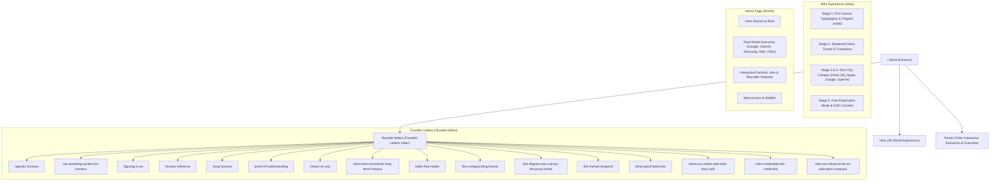

# Zero — Human Infrastructure & 3D Web Experience

An interactive 3D WebGL web platform and Next.js application built with **Three.js**, **GSAP**, hardware-accelerated **KTX2/Basis/Draco** texture transcoders, and **Framer** design engineering. Features an aerial 3D campus world experience including the **Orbix Headquarters**, interactive career scenarios, and founder letters.

---

## 🗺️ Project Site Map



### Route Index Table

| Route | Page Name | Description & Tech |
|---|---|---|
| [`/`](http://localhost:3000/) | **Why Zero 3D** | Interactive 3D WebGL world experience (*Three.js, GSAP, Basis, Draco*) |
| [`/why`](http://localhost:3000/why) | **Why Zero 3D** | Direct route alias to the interactive 3D WebGL experience |
| [`/home`](http://localhost:3000/home) | **Home Page** | Complete storytelling overview with high-res **Orbix** campus scenarios |
| [`/founder-letters`](http://localhost:3000/founder-letters) | **Founder Letters** | Essay directory with complete typography, reading UI, and navigation |
| `/founder-letters/:slug` | **Article Pages** | 16 individual essay pages covering education, human agency, and tech |

---

## 📁 Repository Structure

```text
.
├── zero-next/                         # 🚀 Production Next.js 14 App
│   ├── app/
│   │   ├── layout.jsx                 # App root layout, HTML shell & metadata
│   │   └── page.jsx                   # WebGL canvas (#webgl) & 3D loader
│   ├── next.config.mjs                # Production routing & rewrites
│   ├── package.json                   # Dependencies & build scripts
│   ├── .gitignore                     # Production ignore rules (.next, node_modules)
│   ├── README.md                      # Next.js specific guide
│   └── public/                        # Public static assets & runtime
│       ├── home.html                  # Framer Home experience with Orbix HQ
│       ├── why.html                   # Why 3D page redirector
│       ├── founder-letters.html       # Founder Letters hub
│       ├── founder-letters/           # All individual letter articles
│       ├── assets/                    # 100% locally-hosted assets
│       │   ├── main-B9-HtP-f.js       # Three.js 3D application bundle
│       │   ├── main-yeWZtezw.css      # 3D experience stylesheet
│       │   ├── textures/              # world_city_orbix.jpg & matcaps
│       │   ├── atlases/               # Compressed KTX2 GPU texture atlases
│       │   ├── models/                # 3D GLTF/GLB models (hands, camera, shards)
│       │   ├── origami/               # 3D origami models (goldfish, wolf, cat, etc.)
│       │   ├── audio/                 # Ambience & SFX audio files
│       │   ├── videos/                # Company card MP4 loops
│       │   └── vendor-media/          # Scenario scroller & city assets
│       └── vendor/                    # Hardware decoders (Draco & Basis wasm)
│
├── zero/                              # 📦 Standalone Static HTML Distribution
│   ├── index.html                     # Entry landing page
│   ├── home.html                      # Standalone Home page
│   ├── why.html                       # Standalone Why page
│   ├── founder-letters.html           # Standalone Letters index
│   ├── founder-letters/               # Standalone Letter articles
│   ├── assets/                        # Complete asset mirror
│   └── vendor/                        # Draco & Basis decoders
│
├── README.md                          # Repository overview & site map
└── .gitignore                         # Root ignore patterns
```

---

## ⚡ Quick Start

### Running with Next.js (Recommended)
```bash
cd zero-next
npm install
npm run build
npm start
```
Open **[http://localhost:3000](http://localhost:3000)** in your browser.

### Running in Development Mode
```bash
cd zero-next
npm run dev
```

---

## ☁️ Deployment Guide (Live URL via Vercel)

This repository is optimized for one-click deployment on **Vercel**:

1. Import this repository (`SilentNirab/zero-bdt-experience`) on [vercel.com/new](https://vercel.com/new).
2. Set the **Root Directory** setting to: `zero-next`.
3. Click **Deploy**.
4. Vercel will automatically build the Next.js app and assign a live production URL with free SSL and worldwide CDN edge routing.

---

## 🔒 Asset Integrity
- **100% Locally Hosted**: No reliance on third-party Framer CDN buckets or external video/image hosts.
- **Hardware-Accelerated**: Decodes KTX2/Basis Universal textures directly into GPU-native formats for steady 60 FPS performance.
