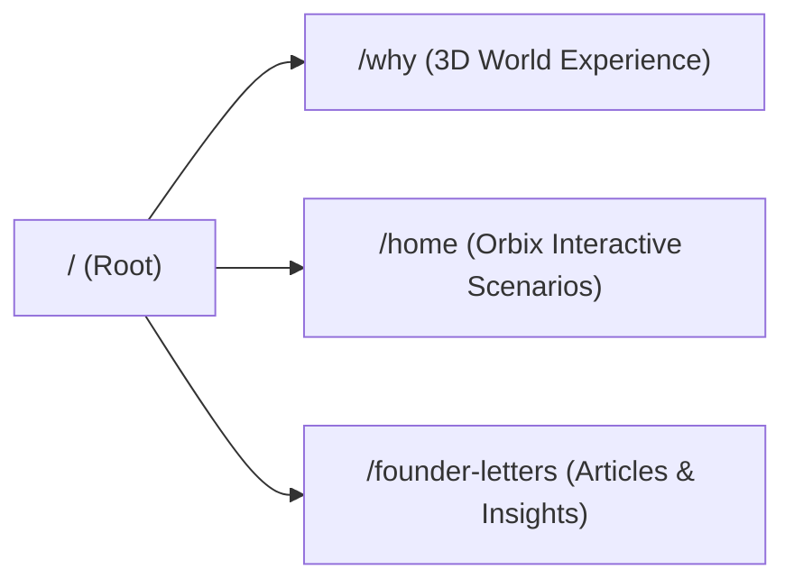

# Zero — Next.js Production Web Application

High-performance Next.js production application combining interactive 3D WebGL experiences with localized Framer-engineered storytelling.

---

## 🗺️ Site Map & Routing



| Route | View | Description |
|---|---|---|
| [`/`](http://localhost:3000/) | **3D World Experience** | Interactive Three.js WebGL World & Campus (*Stage 1-5, Three.js, GSAP*) |
| [`/why`](http://localhost:3000/why) | **3D World Experience** | Direct alias to the interactive 3D WebGL experience |
| [`/home`](http://localhost:3000/home) | **Home Page** | Framer storytelling presentation featuring the completed **Orbix** campus |
| [`/founder-letters`](http://localhost:3000/founder-letters) | **Letters Hub** | Full directory of 16 Founder Letters with responsive reading layout |
| `/founder-letters/:slug` | **Letter Article** | Individual essay articles |

---

## 🚀 Quick Start

### 1. Install Dependencies
```bash
npm install
```

### 2. Development Mode
```bash
npm run dev
```
Open [http://localhost:3000](http://localhost:3000) in your browser.

### 3. Production Build & Start
```bash
npm run build
npm start
```

---

## 📁 Project Architecture

```text
zero-next/
├── app/
│   ├── layout.jsx            # App root layout, HTML tags, and metadata
│   └── page.jsx              # Why Zero 3D experience entrypoint (Three.js WebGL)
├── next.config.mjs           # Clean routing rewrites (/home, /why, /founder-letters)
├── package.json              # Next.js 14, React 18, scripts
├── .gitignore                # Production ignore patterns (.next, node_modules)
└── public/
    ├── home.html             # High-fidelity Framer Home experience with Orbix HQ
    ├── why.html              # Why Zero redirector
    ├── founder-letters.html  # Founder Letters hub
    ├── founder-letters/      # All 14 individual letter articles
    ├── assets/               # 100% locally-hosted audio, video, 3D models, textures
    └── vendor/               # Draco & Basis hardware decoders (wasm)
```

---

## 🔒 Asset Integrity & Hosting
- All assets (3D GLTF models, audio files, video loops, fonts, and textures) are strictly self-contained within `/public/assets/`.
- No dependencies on external CDNs or remote Framer buckets.
